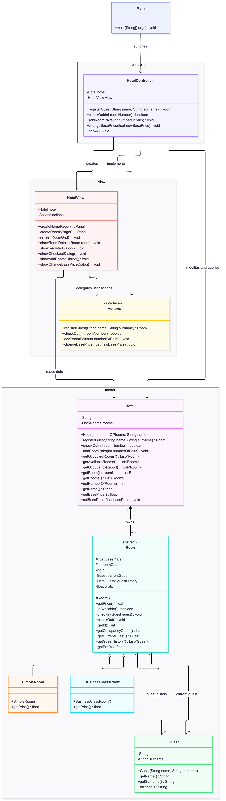

# Hotel Application

## Implementation of the Requirements

### Number of rooms and room pricing
The graphical interface allows the user to add any positive number of room pairs, each containing one room of each class, while preserving the required proportions. The base price can be changed through the **Change base price** option on the home page, and the prices displayed in the room grid are updated accordingly.

### Guest registration

The **Register a guest** button opens a form requesting the guest's name and surname. Both fields must be filled in before registration can proceed. The system automatically assigns the guest to the first available room, regardless of its class. The interface informs the user whether registration succeeded and identifies the assigned room, or reports that registration failed because no rooms are available.

### Guest check-out

The **Check out a guest** button opens a selection window containing the currently occupied rooms and their guests. After the user selects a room, the system checks out its current guest and updates the room's status. The interface then displays the result and refreshes the room grid.

### Reviewing room availability

The room grid provides three filtering options: all rooms, available rooms only, and occupied rooms only. Available rooms are shown in green and occupied rooms in red. Hovering over an occupied room displays the name of its current guest, allowing the user to identify who is staying in each room without opening its details.

### Room occupancy history and status

Clicking on a room opens a detailed view showing whether the room is free or occupied, together with the names and surnames of all guests who have stayed there. The history is displayed in chronological order, from the oldest stay to the most recent. If the room is currently occupied, the current guest is also identified.

### Room occupancy report

The **Show stats** toggle changes the content of each room square to display the number of stays and the profit generated by that room. In this mode, the rooms are sorted by occupancy count, from highest to lowest. Rooms with equal occupancy counts are ordered by room number in ascending order. The filter can also be used to restrict the report to available or occupied rooms.

## Design Choices
### UML

### MVC Architecture

We chose the Model–View–Controller (MVC) architecture to separate the hotel's business logic from its graphical interface. The model manages rooms, guests, prices, and occupancy, while the view is responsible for displaying information and collecting user input. The controller connects the two by handling user actions and calling the appropriate model methods. This separation makes the code easier to understand and maintain, and allows the graphical interface to be modified or replaced without having to rewrite the hotel's underlying logic.

### Use of Inheritance

We chose to make `SimpleRoom` and `BusinessClassRoom` siblings that both inherit from `Room`, rather than making `SimpleRoom` the parent of `BusinessClassRoom`. Although business rooms share most of the properties and behaviours of standard rooms, a business room is not a type of standard room. Both are specializations of the same general concept, `Room`, but have different pricing rules. This design avoids inheriting behaviour from a class that represents a different room category and keeps the hierarchy more coherent and easier to extend with new room types.

### Data Structures

#### Rooms

The hotel stores its rooms in an `ArrayList<Room>`. This choice is mainly practical: most operations involve iterating over all rooms, such as finding an available room, displaying the room grid, or generating statistics. Rooms can also be added easily, and the list can be sorted directly when needed.

Other collections would work too. A `LinkedList` offers no real advantage here. `HashMap<Integer, Room>` would make lookups by room number faster on average. However, for a small hotel, searching through a list is sufficient and keeps the code simple.

Searching for available rooms could be made \(O(1)\) by maintaining two separate lists: one for available rooms and one for occupied rooms. However, this would introduce potential consistency issues, since the occupancy state of a room would be represented both by the room itself and by the list it belongs to. The code would therefore need to ensure that these two representations remain consistent. Since this optimization would provide little practical benefit for a small hotel, we prioritize consistency and simpler code over it.

#### Guest history

Each room stores its guest history in an `ArrayList<Guest>`. The order of insertion corresponds to the order in which guests arrived, which is exactly what the application needs to display. The list also allows the same guest to appear more than once, since a person may stay in the same room several times.

#### Room creation and reports

During initialization, a temporary list of room types is created and shuffled. It contains equal numbers of standard and business rooms, so shuffling randomizes their order without changing their proportions. An enum such as `RoomType` could make these types more readable than Boolean values, but the underlying approach remains the same.

For occupancy reports, the application makes a copy of the room list and sorts that copy by occupancy count, from highest to lowest. This avoids changing the original room order just to display a report. Returning copies from collection getters also prevents callers from directly adding or removing elements in the hotel's internal lists.

## Use of AI

All design and conception choices were made by me. The `model` package was written almost entirely manually, as was the `controller` package. For the graphical interface, I first implemented a simpler version and then used AI to help develop a more sophisticated interface. AI was also used to produce the UML diagram based on a hand-drawn diagram and to help write this README.
